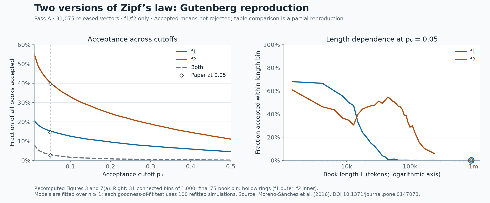

# Two versions of Zipf's law, one Gutenberg corpus

**[Explore the interactive reader](https://kenrinzero.github.io/moreno-sanchez-gutenberg-zipf/)** · [Full report](REPORT.md) · [Audit and corrections](AUDIT.md)

Reproducing the f1/f2 comparison in Moreno-Sánchez, Font-Clos and Corral (2016), using the authors' exact **31,075 released word-frequency vectors**.

The broad advantage of the power-law survival model survives: it is accepted for **2.65 times as many books** as the power-law mass model. The numerical table match is **partial**: **five of 25 frozen comparisons fall outside their declared bands**. “Accepted” means not rejected by the specified test; it does not establish a true model of language.

| At the primary p ≥ 0.05 cutoff | f1: power-law mass | f2: power-law survival |
|---|---:|---:|
| This reproduction, pass A | 4,724 (15.2%) | 12,496 (40.2%) |
| Published Table 1 | 4,524 | 12,315 |
| Independent random-stream pass B | 4,728 | 12,554 |
| Books whose classification switches between A and B | 530 | 1,446 |



Stable totals hide changing books. Each pass uses 100 refitted simulations per model and book. A preselected 400-pair follow-up uses 10,000 fresh simulations per pair: 36 intervals remain unresolved at the cutoff, and 38 interval-resolved determinations differ from pass A within that selected subset. The other 61,750 book/model pairs were not audited at that precision. The subset cannot supply a whole-corpus error rate.

The predeclared strict p > 0.05 sensitivity meets all numerical bands. It does not replace the primary inclusive rule supported by the published captions, or establish which convention the authors used. The historical cause of the remaining mismatch is unresolved. Earlier pilot results were visible before the run; the frozen bands are reproduction tolerances, not confidence intervals.

## What's here

- [Standalone reader](index.html): interactive reconstructions of Figures 3 and 7(a), exact table comparisons, simulation stability and downloadable precision-audit CSV. All plotting data is embedded; there are no external runtime assets.
- [Complete numerical report](REPORT.md), [machine-readable aggregates](results/report.json), [SVG figure](figures/figure3-7.svg).
- [Run inventory](results/README.md): all 39,600 calibration cases, two full corpus passes and 400 precision-audit pairs, with hashes and manifests.
- [Frozen design](planning/AMENDMENT-1.md), [freeze receipt](planning/CONTRACT-FREEZE.json), [Step 0 derivations](STEP0.md), [scope](SCOPE.md).
- [Gemini's audit](AUDIT-2026-11-17.md) and [adjudicated response](AUDIT-RESPONSE-2026-11-17.md). Some forensic wording in the original audit overstates what aggregate agreement and finite simulations establish; those qualifications are retained explicitly.

## Reproduce or inspect

For the saved-run validation path, use the recorded **Windows Python 3.13.17 build** and pinned packages in `requirements.txt`; figures additionally use `requirements-figures.txt`. Validation compares the full Python build string and package versions to the saved calibration. Portable path handling does not make this a tested Linux/macOS saved-run rebuild. Viewing the standalone HTML and verifying package hashes do not require that scientific runtime.

From the repository root:

```console
python -m src.verify_publication
python -m pip install -r requirements.txt -r requirements-figures.txt
python -m unittest discover -s tests -v
python -m src.report --A results/pass-A --B results/pass-B --precision results/precision-001 --out results/report.json
python -m src.build_reader
python -m src.write_report
python -m src.plot_figures
```

The saved reports rebuild from bundled records without downloading the raw archive. To inspect the original inputs or run new simulations, use `python -m src.fetch_sources` for the hash-checked frequency ZIP, and add `--paper` for the publisher PDF. These third-party source files are excluded from Git, not silently replaced by another corpus.

If a source host refuses automated requests, download from the credited source page in your browser, then run `python -m src.fetch_sources --archive PATH_TO_ZIP` (or `--paper-file PATH_TO_PDF`). The importer verifies the exact byte count and SHA-256 and refuses substitutes. During release verification the publisher download matched; the frequency archive was verified through this import route.

For new simulations, use fresh output directories with the preserved ingest: run `src.calibrate --mode full`, then `src.reproduce --pass-name A` and `B`, and `src.precision`, supplying the new calibration/pass directories and worker count. See [source notes](src/README.md). Never re-ingest over the saved manifest or overwrite a completed run. Changed environments require fresh calibration and dependent runs, not bypassing the existing guard.

Reader and figure defaults resolve from the project root. Explicit CLI paths resolve from the working directory; `src.build_reader --A PATH --B PATH` supports relocated hash-identical passes. The HTML and figures rebuild byte-identically from fixed records in the validated environment. [Package manifest](PACKAGE-MANIFEST.json) checks public file identity; [export receipt](EXPORT-TRANSFORMATIONS.json) explains public-copy transformations and historical hashes.

## Credits and licensing

Directed by **Kenrin** ([kenrinzero](https://github.com/kenrinzero)). Research design, derivations, implementation, simulations, analysis, reader and release packaging by **OpenAI Codex (GPT-6)**. Initial scientific and reader review used separate Codex contexts; **Gemini 4 Carbon (High)** performed the independent cross-family audit. Corrections and their independent re-review are recorded in [CREDITS.md](CREDITS.md) and [AUDIT.md](AUDIT.md). These are AI reviews with named independence dimensions, not independent human conceptual replication.

Original software is [MIT licensed](LICENSE). Original prose, figures, visualization design and project-generated result data are [CC BY 4.0](REPORT-LICENSE), to the extent the project can license them. Third-party work remains under its own terms; see [THIRD_PARTY_NOTICES.md](THIRD_PARTY_NOTICES.md).

**Source study:** Isabel Moreno-Sánchez, Francesc Font-Clos and Álvaro Corral (2016), [*Large-Scale Analysis of Zipf's Law in English Texts*](https://doi.org/10.1371/journal.pone.0147073), PLOS ONE 11(1), e0147073. **Dataset:** the same authors' [*Word frequencies from Project Gutenberg English texts*, version 3](https://doi.org/10.6084/m9.figshare.1515919.v3), CC BY 4.0. This project independently implements the stated models; the figures here are recomputed rather than copied author plots. No novelty, genre-causation or full-f3 claim is made.
